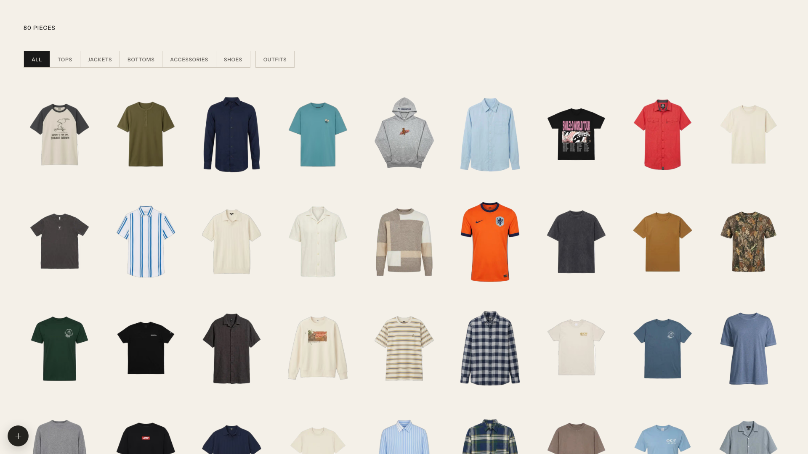
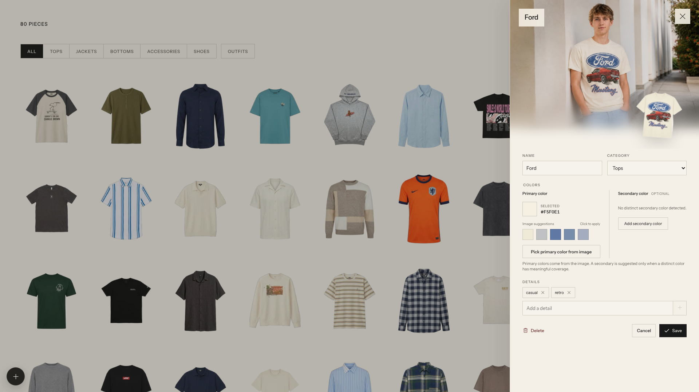

<div align="center">

# Wardrobe

Your clothes, extracted and organized with gpt-image.

[](LICENSE)
[](package.json)

[See the original post →](https://x.com/cdngdev/status/2076812846793650485)

</div>





## Quick start

```bash
git clone https://github.com/tandpfun/wardrobe.git
cd wardrobe
npm install
cp .env.example .env
npm run dev
```

⚠️ The importer stays disabled until you add `OPENAI_API_KEY` to `.env` and place a PNG reference photo of yourself at `data/model-reference.png`.

Open [localhost:5173](http://localhost:5173).

## Import with Codex

This repo includes two Codex skills: one imports clothes and generates modeled item photos; the other styles complete outfits and generates a modeled lookbook.

```text
$import-clothes Import the clothes from ~/Pictures/outfits, create modeled photos, and add them to this wardrobe.
$generate-outfits Create modeled outfit ideas from my wardrobe.
```

Open the cloned repo in Codex and run either prompt. The import skill asks for a local model-reference PNG when needed, reviews every cutout and modeled photo, then writes to `data/library.json` and `data/imported/`. The outfit skill asks how many looks to create, then curates, generates, verifies, and saves the complete collection under `data/`.

### For agents

If you are setting up Wardrobe for a user, ask how they want to import their clothes:

- **Codex:** Ask for a folder or camera-roll location and a model-reference PNG, then extract, model, and import the individual pieces by following [the bundled import skill](.agents/skills/import-clothes/SKILL.md). Afterward, offer to create a requested number of modeled looks with [the outfit-generation skill](.agents/skills/generate-outfits/SKILL.md).
- **Web UI:** Help the user configure their own `OPENAI_API_KEY` and `data/model-reference.png`, then let them import through the app.

## What it does

- Detects every garment in a photo with the OpenAI Responses API
- Extracts clean product cutouts with the OpenAI Images API
- Generates an optional modeled editorial preview
- Keeps originals, jobs, generated images, and the JSON database in `data/` locally, or in Netlify Blobs when deployed
- Supports drag, drop, paste, editing, review, regeneration, and approval

## Configuration

| Variable | Default |
| --- | --- |
| `OPENAI_API_KEY` | Required |
| `OPENAI_VISION_MODEL` | `gpt-5.4-mini` |
| `OPENAI_IMAGE_MODEL` | `gpt-image-2` |
| `OPENAI_IMAGE_QUALITY` | `high` |
| `OPENAI_CATALOG_QUALITY` | `low` (catalog imports) |
| `PHOTOROOM_API_KEY` | Optional, enables the Photoroom catalog import |
| `WARDROBE_DATA_DIR` | `data` |
| `APP_PASSWORD` | Optional locally, required on Netlify |

## Deploy to Netlify

The same API runs on Netlify: `netlify/functions/api.mjs` serves `/api/import/*`, data is stored in Netlify Blobs instead of `data/`, and AI image generation runs in `netlify/functions/worker-background.mjs` so it is not cut off by the 60-second request limit.

1. Import the GitHub repository in Netlify. `netlify.toml` provides the build settings.
2. Under **Project configuration → Environment variables**, add `APP_PASSWORD` (the password for the site) and `OPENAI_API_KEY`.
3. Deploy, open the site, sign in with the password, and upload a model reference photo.

The shared code lives in `server/`: `wardrobe-api.mjs` (routes and image processing), `stores.mjs` (local folder and Netlify Blobs storage), and `auth.mjs` (password session cookie).

## License

[MIT](LICENSE)
